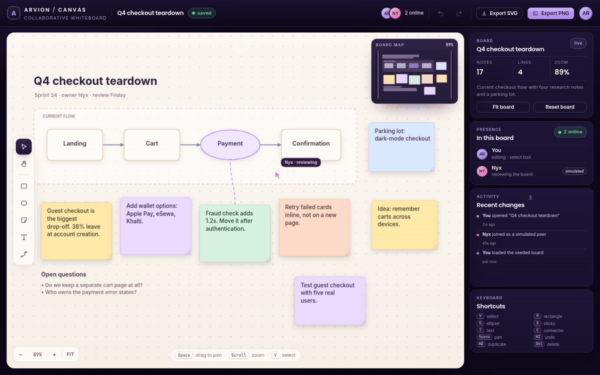
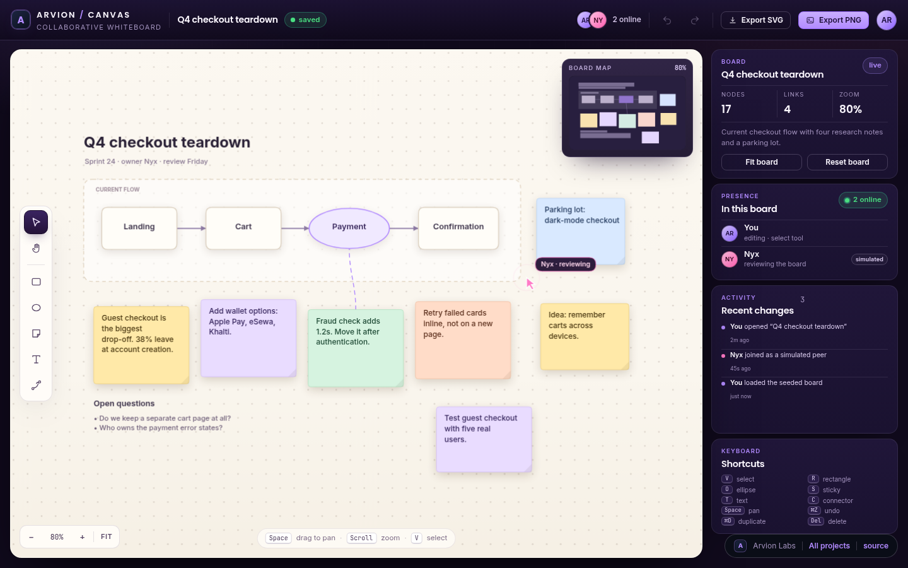
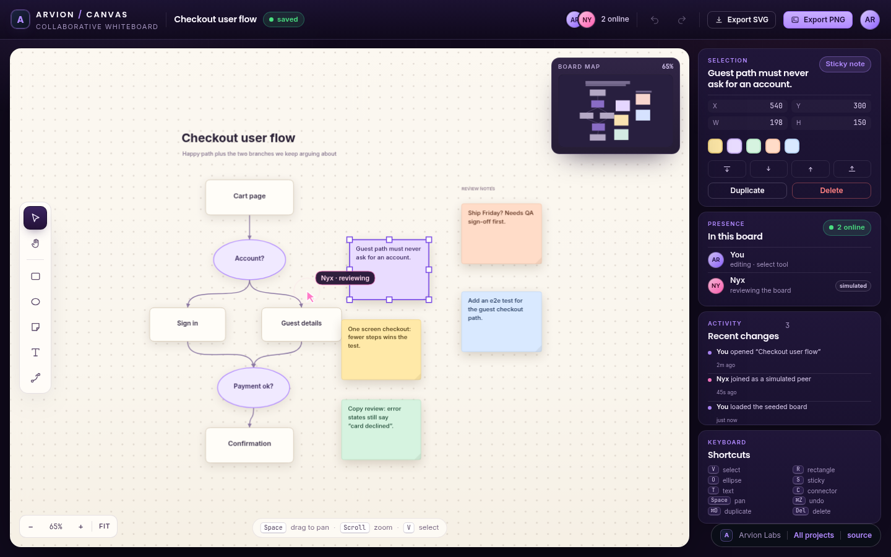

<div align="center">

</div>

<sub>Recorded from the live demo, <a href="docs/demo.mp4">MP4</a> · <a href="docs/screenshot.png">static frame</a></sub>

# Canvas

An infinite whiteboard that runs entirely in the browser. Pan and zoom, drop
sticky notes, draw rectangles and ellipses, connect shapes with arrows, resize a
selection, and export the board as PNG or SVG. No build step, no dependencies,
no server.

[**Open the live demo**](https://arvion-technology.github.io/labs/demos/whiteboard/demo/) · [MIT](LICENSE)

Canvas is the collaboration sample in the Arvion Labs series. The interesting
part is the small scene model underneath the drawing: a camera transform you can
invert, hit-testing that behaves the same at every zoom level, connectors that
re-anchor when either endpoint moves, and snapshot history that makes undo work
for multi-shape edits. A second cursor moves around the board and leaves notes;
that collaborator is simulated in the page.

## What it does

- **Infinite canvas** with a dot grid, wheel zoom anchored at the pointer, and
  panning with Space+drag, middle-drag, or the hand tool. Fit-to-board and the
  minimap keep a large board navigable.
- **Tools** for select, rectangle, ellipse, sticky note, free text and connector.
  Drag to draw, double-click a note to edit its copy, double-click empty canvas
  to drop a sticky.
- **Selection** with shift-click, marquee drag, eight resize handles, proportional
  group resize, arrow-key nudging, duplicate, delete, and four z-order moves.
- **Connectors** that choose the nearest facing sides, bow out of both shapes, and
  recompute their anchors whenever a shape is moved or resized.
- **Undo and redo** over labelled scene snapshots, including peer edits.
- **Simulated peer** that wanders between shapes, adds a note every few seconds,
  nudges stickies, and shows up in the presence list and activity feed.
- **Two seeded boards** (a checkout teardown and a user flow) plus a reset action.
- **PNG and SVG export** that download a real file from the current scene, with
  the same shapes and the same text wrapping the canvas uses.
- **Board chrome** for the demo itself: presence, activity, selection inspector,
  board stats and a shortcut reference.

## Screenshots

| Checkout teardown board | Selection and flow view |
| --- | --- |
|  |  |

The second view is a deep link: open `#flow` on the demo URL. It loads the user
flow board with a note selected so the inspector and resize handles are visible.

## Architecture

```
 browser
 ├── demo/                    static app: index.html + app.js (renderer and input)
 │    ├── arvion.css          design tokens, shell, components
 │    ├── styles.css          board chrome, warm board surface, rail cards
 │    └── arvion.js           shared formatting, toasts, helpers
 │
 ├── src/transform.js         screen ↔ world math, cursor-anchored zoom, fit
 ├── src/geometry.js          rects, ellipses, bezier sampling, distances
 ├── src/shapes.js            shape factories, text wrapping, sticky palette
 ├── src/connectors.js        side selection, anchors, bezier path, arrowheads
 ├── src/scene.js             z-ordered scene, hit-testing, duplicate, bounds
 ├── src/selection.js         selection bounds, handle hit-testing, resize math
 ├── src/history.js           labelled snapshots with a capped timeline
 ├── src/peer.js              seeded simulated collaborator
 ├── src/export.js            standalone SVG document and export sizing
 ├── src/board.js             the two seeded boards
 └── test/                    59 node:test cases over the modules above
```

The scene is a plain object and the only state the app cares about:

```js
{
  version: 1,
  name: "Q4 checkout teardown",
  shapes: [
    { id: "sprint-cart", type: "rect", x: 300, y: 168, w: 150, h: 84, label: "Cart" },
    { id: "sprint-payment", type: "ellipse", x: 506, y: 170, w: 160, h: 80, label: "Payment" },
    { id: "sprint-c2", type: "connector", from: "sprint-cart", to: "sprint-payment",
      fromSide: "auto", toSide: "auto", arrow: true }
  ]
}
```

Array order is paint order, so z-order is just a splice. Connectors store shape
ids, never coordinates, which is why moving a node cannot leave an arrow behind.

## Quickstart

```bash
git clone https://github.com/arvion-technology/whiteboard.git
cd whiteboard
npm test          # 59 tests, no dependencies, Node 20+
npm run demo      # serves the static app on http://localhost:4173
```

There is nothing to install. `package.json` exists so `npm test`, the CI matrix
and the screenshot scripts have a standard entry point.

```bash
npm run shot      # writes docs/screenshot.png with headless Chromium
npm run shot:2    # writes docs/screenshot-2.png from the #flow deep link
npm run verify    # unit tests plus the demo asset check
```

## How it works

**The camera is three numbers.** `panX`, `panY` and `zoom` map world to screen as
`screen = world * zoom + pan`. That form inverts directly, so cursor-anchored
zoom is a one-step correction instead of a matrix inversion:

```js
const world = screenToWorld(camera, anchor);
const nextZoom = clampZoom(camera.zoom * factor);
return {
  zoom: nextZoom,
  panX: anchor.x - world.x * nextZoom,
  panY: anchor.y - world.y * nextZoom,
};
```

The tests run that round-trip through several cameras and assert that a point
under the cursor does not drift after a chain of zooms.

**Hit-testing works from the top down.** Nodes are tested in reverse paint order
before connectors, so a connector under a sticky cannot steal the click. Ellipses
use the normalised ellipse equation rather than their bounding box, and text
shapes get a few pixels of padding. Connectors are sampled along the bezier and
measured to the polyline; the tolerance is specified in screen pixels and divided
by zoom before comparison, so a 7 px target stays a 7 px target at 20% or 300%.

**Connectors own no geometry.** `connectorGeometry` looks up both endpoint shapes,
picks the axis with the larger gap between their boxes, anchors to the midpoint of
the chosen sides, and builds a cubic bezier whose control points leave each shape
perpendicular to its side. It runs during paint and during hit-testing, so moving
a shape is enough to move the arrow; there is no cached anchor to invalidate. A
dangling connector (one endpoint deleted) returns `null` and is skipped.

**History is snapshots, not commands.** A whiteboard scene is a few hundred plain
objects, so cloning it is cheaper than maintaining inverse operations for every
gesture. Each commit stores a labelled snapshot; undo moves the index; a new edit
after an undo drops the redo branch, which is what people expect. The timeline is
capped at 80 snapshots so a long session cannot grow without bound. Because peer
operations are committed on the same timeline, undo reverses them too.

**The peer is a seeded state machine.** `stepPeer(peer, dt, scene)` moves a cursor
toward a waypoint just outside a random shape, decrements a cooldown, and returns
an operation (`place-sticky` or `nudge`) instead of touching the scene itself. The
demo applies the operation, commits it and logs it. There is no WebSocket, no
presence protocol and no merge logic; a second tab would have an independent board.

**Exports reuse the scene, not the DOM.** The SVG exporter walks the same shapes
and the same wrapping function as the renderer, emits plain `<rect>`, `<ellipse>`,
`<text>` and `<path>` elements, and needs no external asset. PNG is rasterised by
the browser renderer at 2x into an offscreen canvas, then handed to a download
blob. Text wrapping uses a fixed 0.52 em advance width so the SVG export is
deterministic without font metrics; the trade-off is documented below.

## Tests

```bash
npm test
```

59 `node:test` cases cover:

- transform round-trips, cursor-anchored zoom, clamping, fit and visible bounds
- hit-testing for rectangles, ellipse interiors, sticky notes, free text,
  top-most ordering, and connector curves with zoom-aware tolerance
- connector side selection, re-anchoring after either endpoint moves, side flips,
  explicit side overrides, dangling connectors, arrowheads and path serialisation
- selection handle positions and hit radii, single and group resize, selection
  bounds for nodes and connectors
- undo/redo, redo-branch truncation, no-op commits, snapshot limits and labels
- SVG serialisation: ids, sticky fills, escaped copy, arrowheads and dimensions
- the simulated peer's determinism, movement and operation order
- both seed boards: ids resolve, connectors connect, and the seeds are identical
  across loads

The demo bundle has its own static check:

```bash
node scripts/serve-check.mjs
```

It verifies every local asset reference resolves, that the brand stylesheet and
fonts are present, that the two screenshots exist, and that no placeholder text
ships in the page.

## Limitations

- **The collaborator is simulated.** There is no networking, authentication or
  conflict resolution; the peer is a local state machine. Real multi-user editing
  would need a transport and a merge model (CRDT or OT), and none of that is here.
- **Nothing persists.** Reloading the page restores the seed board and clears the
  history. There is no localStorage, login, sharing link or server.
- **Text wrapping is estimated.** The renderer and the SVG exporter share a fixed
  character-advance estimate instead of measuring every glyph. It keeps the export
  deterministic and dependency-free, but a line break can differ by a word from a
  pixel-accurate measurement in a different font.
- **Shapes are axis-aligned.** No rotation, grouping, images, freehand ink, or
  labels attached to connectors. Those would all change the hit-testing and resize
  model, so they are deliberately out of scope.
- **PNG export renders the whole board at 2x.** A very large board produces a
  large bitmap; there is no tile-based export.

## Project layout

```text
whiteboard/
├── demo/               static app (no build step)
│   ├── index.html      toolbar, canvas, minimap, rail
│   ├── app.js          rendering, pointer input, inspector, exports
│   ├── styles.css      board chrome and warm board palette
│   ├── arvion.css      design tokens, shell, components
│   ├── arvion.js       shared helpers and toasts
│   └── fonts/          self-hosted Inter and Poppins
├── src/                ten framework-free ES modules (the real logic)
├── test/               59 node:test cases
├── scripts/            serve, screenshot, bundle check
├── docs/               screenshots and recorded demo
└── .github/workflows/  CI: tests on Node 20 and 22
```

## Credits

Built by [Arvion Technologies](https://arviontech.net) in Kathmandu as part of our
open-source [Labs](https://github.com/arvion-technology/labs) series. We build web
platforms, mobile apps and cloud systems for clients; the demos are a fair sample
of how we work.

MIT licensed.
